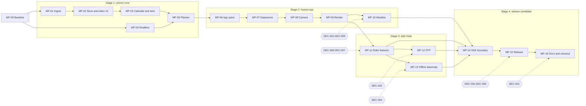

> Project copy of `docs/recovery/MASTER_PLAN.md` from `Metro-IntelliTrip-recovery-overlay-2026-11-02.zip`. Links are relative to `docs/recovery/` in the repo.

# Metro IntelliTrip: Recovery Master Plan

**Date:** 2026-11-02
**Baseline:** `master` @ `5032833`
**Sources:** `AUDIT-2026-11-02.md` (73 findings) and `FINDINGS-ADDENDUM.md` (N-1)
**Scope:** 17 phases (MP-00 to MP-16) and 9 decisions (DEC-001 to DEC-009)
**Anchor:** `$INTELLITRIP_ROOT`

## 1. The story so far

Metro IntelliTrip grew the way good side projects do, one honest phase at a time:

- Phase 00 laid down portable, Android-free core modules.
- Phase 01 taught the app to read Metro Transit's GTFS and keep stop times in a disk index.
- Phase 03 put live vehicles on a MapLibre map.
- Phase 05 added a scope engine, so the camera, the data window and the render budget could move independently.
- Phase 06 added a planner, and Phase 09 drew an SDK facade around the whole thing.

By October the architecture diagram was credible and CI was green on every push.

The 2026-11-02 audit read every file and ran the core modules against small scenarios. It found a system
whose tests check its *shape* rather than its *promises*:

- **Planner:**
  - It never asks what day it is, so a Saturday plan lists weekday buses.
  - It can't find a trip that needs a transfer.
  - It tells a rider 1.5 km away to "walk" to an 08:00 bus that departs at 08:00.
- **Departure board:** it shows timetable times in the phone's time zone and calls them "Live".
- **Map:** it snaps back after every pinch, because a gesture becomes a radius and the radius becomes a
  zoom again through a different formula.
- **Radar:** its URL is missing half its template.

None of this is exotic. Each is one missing input or one wrong formula. Together they mean the app can't
yet be trusted for the trip that matters most: a Saturday ride with a transfer.

This plan doesn't start over, because the bones are good: a pure-Kotlin core, a disk index, a scope model
and provider contracts. Instead it repairs the truth from the bottom up:

1. **Data:** what the feed says.
2. **Time:** which day and which zone.
3. **Search:** which journeys exist.
4. **App spine:** what the UI may do on the main thread.
5. **What the rider sees.**
6. **New features, then the release.**

Each phase leaves the system more correct than it found it, and proves it with a test that failed
beforehand.

## 2. What "recovered" means

The program is done when all of these are true and evidenced:
1. A Saturday 10:00 plan from Terminal 1–Lindbergh to East Bank returns a Blue Line (901) → Green Line
   (902) journey. Every leg is catchable, meaning each walk ends before its boarding.
2. The departure board for any stop:
   - lists only trips running on that service day,
   - shows times in America/Chicago,
   - labels predicted and scheduled times honestly,
   - never crashes on duplicate rows.
3. The map stays exactly where the rider leaves it, and programmatic framing fits real geometry.
4. Radar paints precipitation from a source the owner is licensed to use, with attribution.
5. Predictions and service alerts from Metro Transit reach the board, the stop sheet and the planner.
6. Cold start never needs the network, and a corrupt file never silently erases a rider's data.
7. CI builds the minified release and freezes the SDK's public API.
8. Every document describes the code as it is today.
9. A fresh re-audit finds no open Critical or High issue.

## 3. How we work
- **Truth before features.** Data, time and search are correct before any new UI is built.
- **Test-first from the audit.** Every finding task starts with a test that reproduces the audit's
  evidence and fails.
- **One seam per phase.** Each phase owns a declared set of paths. Touching anything else is a stop, not a
  shortcut.
- **Expand, adapt, contract.**
  - Core phases add correct APIs.
  - The app adapts only at call sites until its own phases.
  - MP-14 contracts the public surface and freezes it.
- **Decisions are human-owned.** A decision is recorded before the phase that needs it starts. The agent
  supplies facts and a non-binding recommendation.
- **Local-first.**
  - No network at startup and none in default tests.
  - Origin and destination stay on the device unless the rider opts into remote routing.
- **No database layer.** Persistence stays in atomic file stores. The stop-time index is a versioned
  binary file, not a database.
- **Evidence over assertion.** A phase is DONE when its gate report says PASS and links the proof.

## 4. Trajectory: four stages

| Stage | Phases | What you can demo at the end |
|---|---|---|
| 0 · Baseline | MP-00 | Overlay committed; today measured: test counts, real-feed timings, both phones |
| 1 · Correct core | MP-01 … MP-05 | JVM: Saturday plan with a real transfer, DST-day times right, UTF-8 names, transactional refresh |
| 2 · Honest app | MP-06 … MP-10 | Both phones: calendar-true board with predictions, map that stays put, valid styling, radar |
| 3 · Rider beta | MP-11 … MP-13 | Search, my location, arrive-by, alerts; remote routing per DEC-003; offline basemap per DEC-004 |
| 4 · Release candidate | MP-14 … MP-16 | Frozen SDK API, minified release from CI, truthful docs, clean re-audit |

## 5. Phase map

| Phase | Title | Lane | Size | Depends | Needs | Fixes |
|---|---|---|---|---|---|---|
| [MP-00](blueprints/MP-00-baseline.md) | Baseline & guardrails | P | S | — | — | U-10, B-3, B-4 |
| [MP-01](blueprints/MP-01-gtfs-ingest.md) | GTFS ingest correctness | A | M | MP-00 | — | H-4, M-8, L-3, D-9, N-1 |
| [MP-02](blueprints/MP-02-snapshot-index.md) | Snapshot store, streaming ingest & index v3 | A | L | MP-01 | — | M-7, M-8, M-9, M-10, H-3, B-5 |
| [MP-03](blueprints/MP-03-service-calendar.md) | Service calendar & service-day time | A | M | MP-02 | — | C-1, H-7 |
| [MP-04](blueprints/MP-04-realtime.md) | Realtime adapter correctness | B | M | MP-00 | — | H-5, H-6, L-6, U-2, U-3, U-8, M-23 |
| [MP-05](blueprints/MP-05-planner.md) | Planner rebuild (RAPTOR-lite) | A | XL | MP-03, MP-04 | — | C-1, C-2, C-3, H-7, M-1, M-2, M-10, M-16, U-1 |
| [MP-06](blueprints/MP-06-app-spine.md) | App spine | D | L | MP-05 | — | H-3, M-5, M-6, M-7, M-9, M-10, M-17, M-21, M-22, D-10, L-9 |
| [MP-07](blueprints/MP-07-departures.md) | Departures & stop detail | D | M | MP-06 | — | C-1, H-1, H-2, H-3, H-7, L-9, U-2 |
| [MP-08](blueprints/MP-08-camera-scope.md) | Camera, scope & lifecycle | D | M | MP-07 | — | C-5, M-14, M-15, M-19, M-20, L-2, B-1 |
| [MP-09](blueprints/MP-09-render-style.md) | Rendering, styling & selection | D | M | MP-08 | — | M-4, M-12, M-13, L-4, L-5, L-7, L-8, L-9 |
| [MP-10](blueprints/MP-10-weather.md) | Weather & radar | C | M | MP-09 | DEC-002, DEC-009 | C-4, M-3, M-18, L-1, U-7, U-8, D-3 |
| [MP-11](blueprints/MP-11-rider-features.md) | Rider features | D | L | MP-09 | DEC-006, DEC-007 | U-1, U-2, U-3, U-4, M-16, L-9, D-7 |
| [MP-12](blueprints/MP-12-otp.md) | Remote routing (OTP) | D | M | MP-11 | DEC-003 | M-11, U-6, D-6 |
| [MP-13](blueprints/MP-13-offline-basemap.md) | Offline basemap | D | M | MP-11 | DEC-004 | U-5 |
| [MP-14](blueprints/MP-14-sdk-boundary.md) | SDK boundary | P | M | MP-10, MP-11, MP-12, MP-13 | — | M-23, U-8, U-10 |
| [MP-15](blueprints/MP-15-release.md) | Release & build hygiene | P | M | MP-14 | DEC-005, DEC-008 | B-1, B-2, B-4, B-5, U-9, D-11, D-13, L-10 |
| [MP-16](blueprints/MP-16-docs-closeout.md) | Docs truth & closeout | P | M | MP-15 | DEC-001 | D-1, D-2, D-4, D-5, D-8, D-12, D-13 |

Some findings span phases on purpose. C-1 (service calendars) is fixed in the domain (MP-03), the
planner (MP-05) and the board (MP-07), and it closes only when all three gates pass.

## 6. Dependency graph

## 7. Lanes and parallel work
- **Lane A, data core (MP-01 → MP-02 → MP-03 → MP-05):** strictly serial. Each phase consumes the
  previous one's contracts.
- **Lane B, realtime core (MP-04):** may run beside MP-01 to MP-03.
  - It owns `core/atlas-gtfs-realtime` plus the realtime domain and contract files.
  - It leaves the app untouched, because its new constructor parameters have defaults.
  - Confirm with `trace overlap MP-04 MP-0x` before starting it in parallel.
- **Lane D, app (MP-06 → MP-09, then MP-11):** serial, because these phases share the ViewModel,
  `MainActivity` and `MapCanvas`.
- **Lane C, weather (MP-10):** follows MP-09, because its renderer and chrome edits overlap MP-09's.
  - Its pure `core/atlas-weather` tasks are conflict-free.
  - If radar becomes urgent, a human may re-sequence the whole phase. Don't split it.
- **MP-12 and MP-13:** both are unblocked by MP-11, but they overlap in the app layer. Run them one after
  the other, in either order.
- **With one agent:** follow `trace next`. It returns the earliest eligible phase in plan order and lists
  anything else that is eligible.

## 8. Decisions (human-owned)

| ID | Question | Needed before | Recorded as |
|---|---|---|---|
| [DEC-001](decisions/DEC-001-default-branch.md) | Which branch is GitHub's default and the integration branch? | MP-16 | ADR-015 |
| [DEC-002](decisions/DEC-002-radar-source.md) | Which radar source, under which license? | MP-10 | ADR-016 |
| [DEC-003](decisions/DEC-003-remote-routing.md) | Rebuild remote routing on OTP 2.x, or retire it? | MP-12 | ADR-017 |
| [DEC-004](decisions/DEC-004-offline-basemap.md) | Which offline basemap format? (PMTiles needs MapLibre ≥ 11.7.0) | MP-13 | ADR-018 |
| [DEC-005](decisions/DEC-005-atlas-transit.md) | Should `core/atlas-transit` be excluded from the build or deleted by the human? | MP-15 | ADR-019 |
| [DEC-006](decisions/DEC-006-schedule-refresh.md) | How are schedule refreshes prompted without startup network? | MP-11 | ADR-020 |
| [DEC-007](decisions/DEC-007-place-search.md) | Place search: offline stops only, or a geocoder too? | MP-11 | ADR-021 |
| [DEC-008](decisions/DEC-008-release-signing.md) | Which release channel, and who holds the signing key? | MP-15 | ADR-022 |
| [DEC-009](decisions/DEC-009-forecast-traffic.md) | Weather forecast and traffic: build, retire, or defer? | MP-10 | ADR-023 |

- **Timing:** what matters is when decisions land, not how quickly each is made. DEC-002 to DEC-009 should
  be recorded by the time lane D reaches MP-10. Otherwise the program waits at MP-14, which freezes the
  API only after every feature decision has landed.
- **ADR numbers:** they're pre-assigned so phases can run in any order without collisions. ADR-012 and
  ADR-013 were never committed, and MP-16 indexes that gap.

## 9. Effort and cadence
- **Total:** sizes add up to roughly 45–65 agent sessions, or about 45–55 if DEC-003 retires OTP. A
  session is about 1–2 hours of agent work plus human review.
- **Pace:** at four sessions a week that's about three to four months. Lane B in parallel saves roughly
  two weeks.
- **Heaviest phases:**
  - MP-05, the planner, is XL. Its T1 goldens are written first, so the search is built against fixed
    expectations.
  - MP-02 (store and index) and MP-06 (app spine) are L, and both carry most of the memory and
    threading risk.

## 10. Risks

| Risk | Early signal | Mitigation |
|---|---|---|
| Real-feed memory on D2 (BLU View 5) | OOM or ANR during refresh | MP-02 streaming parse with a 512 MB JVM gate; MP-06 device check; `largeHeap` removed only after proof (MP-15) |
| Planner latency on device | > 3 s p50 on D2 | Index v3 per-stop departures, bounded access stops, rounds ≤ maxTransfers + 1 (MP-05 G3) |
| Agent drift: unowned files, fixes "in passing" | `trace diffcheck` failures | OWNED PATHS, deny rules, explicit staging, PR-REVIEW, independent review for C/H |
| Radar license | DEC-002 rules out RainViewer | IEM provider behind the same interface; radar stays out of public builds until decided |
| MapLibre bump for PMTiles changes rendering | DEVICE-SMOKE S-03 or S-09 regress | Spike first, isolated commit, no other upgrades alongside (MP-13) |
| AGP or CI upgrades break the build | CI red after a bump | One version step per commit, CI between steps (MP-15) |
| Feed changes under the tests | Real-feed counts drift | Goldens use fixtures; real-feed tests are opt-in, with tolerances |
| Decisions stall | `trace next` shows WAITING | Recommendations in each DEC; MP-14 is the hard stop |
| Protected work in `core/atlas-transit` lost | n/a | Edit deny rule; never staged; DEC-005 executed by the human only |

## 11. Definition of done (program)
- [ ] `trace check --strict` exits 0, and `TRACEABILITY.md` shows every audit and addendum finding closed,
      or WONTFIX by a DECIDED decision.
- [ ] All 17 gate reports say `Result: PASS`.
- [ ] CI is green on the integration branch for every job: unit tests, lint, `assembleDebug`,
      `assembleRelease` (minified), `apiCheck`, the SDK consumer smoke, the sample host, and instrumented
      tests on both the debug and the minified build.
- [ ] DEVICE-SMOKE S-01 to S-15 pass on D1 and D2 with the release build.
- [ ] RELEASE-READINESS and DOCS-TRUTH are complete.
- [ ] The MP-16 re-audit, done by a fresh session, reports zero open Critical or High findings.

## 12. What this plan deliberately doesn't do
- Rewrite the app, or restyle it beyond what fixes require (dark basemap, standard sheets).
- Add a database, a DI framework, analytics, accounts or API keys.
- Build traffic, fares or accessibility-aware routing. Those are for DEC-009 or later work.
- Touch `core/atlas-transit`.
- Fix anything "in passing". Every change has a task, and every task has a finding.

## 13. Reading order
1. This file.
2. `AGENT_PROTOCOL.md`, which states the rules.
3. `decisions/README.md`, which shows what you need to decide and when.
4. `blueprints/MP-00-baseline.md`, then run it with the prompt in `README.md`.
